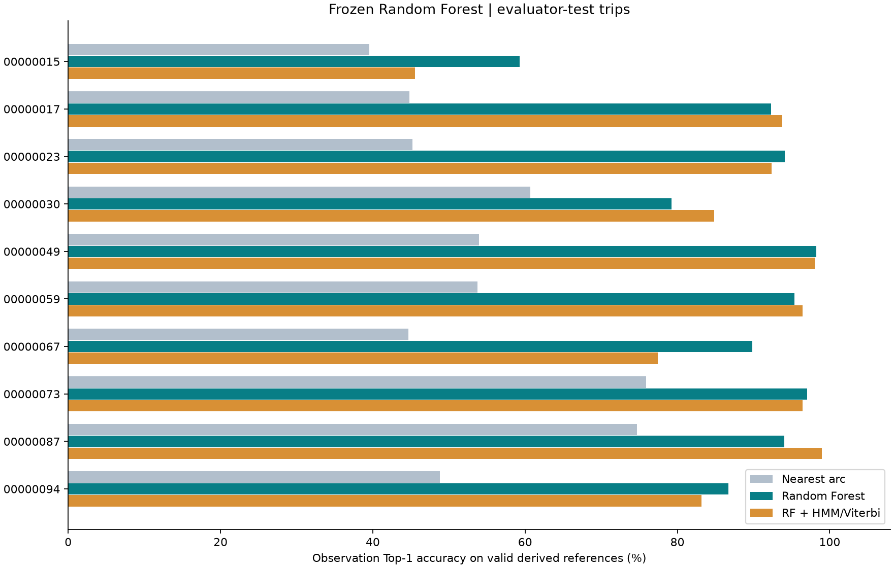

# Random Forest: evaluator-test results

Measured after selecting Random Forest. Classifier and decoder settings were fixed before evaluator scoring; no evaluator tuning was used.

## Overall results

| Measure | Value |
|---|---:|
| Evaluator trips | 10 |
| GPS observations | 19,674 |
| Valid derived-reference observations | 19,653 |
| Unresolved-reference observations | 21 |
| Reference coverage | 99.89% |
| Correct known-reference observations | 15,872 |
| Pooled observation Top-1 accuracy | **80.76%** |
| Mean per-trip Top-1 accuracy | 88.61% |
| Nearest-arc baseline Top-1 | 49.80% |
| RF + HMM/Viterbi observation Top-1 | **75.41%** |
| RF + HMM mean per-trip Top-1 | 86.70% |
| Binary candidate Macro F1 | 0.8918 |
| Binary candidate log loss | 0.0595 |
| Known-reference candidate miss rate | 0.00% |
| Zero-candidate observations (all references) | 0 |

Top-1 counts candidate misses and zero-candidate observations with known references as errors. Unresolved references are excluded from accuracy, F1 and log-loss denominators. Macro F1 and log loss are candidate-level binary metrics, not route-level metrics.

## Per-trip performance

| Trip | GPS points | Known reference | Unresolved | RF Top-1 | Nearest Top-1 | HMM Top-1 |
|---|---:|---:|---:|---:|---:|---:|
| 00000015 | 6,854 | 6,833 | 21 | 59.30% | 39.56% | 45.57% |
| 00000017 | 1,346 | 1,346 | 0 | 92.27% | 44.80% | 93.76% |
| 00000023 | 458 | 458 | 0 | 94.10% | 45.20% | 92.36% |
| 00000030 | 654 | 654 | 0 | 79.20% | 60.70% | 84.86% |
| 00000049 | 2,642 | 2,642 | 0 | 98.26% | 53.97% | 98.03% |
| 00000059 | 1,031 | 1,031 | 0 | 95.34% | 53.73% | 96.41% |
| 00000067 | 916 | 916 | 0 | 89.85% | 44.65% | 77.40% |
| 00000073 | 1,144 | 1,144 | 0 | 97.03% | 75.87% | 96.42% |
| 00000087 | 1,399 | 1,399 | 0 | 94.07% | 74.70% | 99.00% |
| 00000094 | 3,230 | 3,230 | 0 | 86.72% | 48.79% | 83.16% |



## Training and interpretation

The model was refitted on 78 eligible training trips (2,597,756 candidate rows). It uses 200 trees, seed 42, median imputation fitted on eligible training data, and the original baseline classifier settings. Training took 1208.6 seconds. Trips 00000033 and 00000054 remain excluded. No student/evaluator rows entered fitting.

Previously recorded five-fold CV Top-1 was 85.63% (mean across folds). The refitted model's student-test Top-1 is 87.27%. Evaluator Top-1 is pooled across valid-reference observations; these aggregation schemes are different.

Reference arc IDs were derived by the existing monotone alignment to each .route, with a 50 m reference-validity threshold fixed before evaluation. These are not independent pointwise labels. The candidate search radius is 75 m, so validity filtering makes known-reference candidate recall appear especially high. No evaluator trips were excluded for poor reference coverage; unresolved observations are counted explicitly.

Predictions for all evaluator trips were saved before the first evaluator .route was read. The saved model and prediction files are SHA-256 tracked. References are used only in the separate evaluation phase. Evaluator outcomes must not be used to retune this benchmark.

## Local artifacts and reproduction

- Frozen model: `outputs/training/random_forest_selected_001/pipeline.joblib` (local, ignored by Git).
- Label-free predictions: `outputs/evaluation/evaluator_test_rf_hmm_001/predictions/<trip_id>/`.
- Reference-bearing comparisons: `outputs/evaluation/evaluator_test_rf_hmm_001/evaluation/<trip_id>/`.
- Model SHA-256: `726b503c4ec431232411dcc94f2b443156d6ea43f2ee7bf0fcb8e19a29dc2399`.

```bash
python -m pathsnap.selected_forest \
  --output outputs/training/random_forest_selected_001 --jobs 2
python -m pathsnap.evaluate_forest \
  --model-dir outputs/training/random_forest_selected_001 \
  --data-root .. \
  --output outputs/evaluation/evaluator_test_rf_hmm_001 --with-hmm
```

Use a fresh output directory for each run. Obtain the original raw data and rebuild outputs/features first when working from a new clone. Training artifacts and evaluator data are deliberately not uploaded to Git.

## Measured outcome

RF + HMM lowered pooled Top-1 by 5.35 percentage points in this run. The decoder provides connected road segments, but this benchmark does not establish a pointwise accuracy improvement. All reconstructed segments passed directed-adjacency checks before evaluation. Decoder settings remain fixed; evaluator outcomes were not used to retune them.

## HMM settings and limits

Directed metric shortest paths, partial-arc travel and GPS displacement are used in the transition potential. beta=50 m, max gap=30 s, max speed=60 m/s, and max transition distance=5,000 m were fixed before evaluator references were read. Empty/disconnected/time-gap segments are explicit; intermediate road arcs are reconstructed. These settings have not undergone decoder parameter optimization.

HMM Top-1 measures decoded per-observation choices against the same valid derived references as the classifier baseline. It does not establish an independently verified route-level accuracy score.
