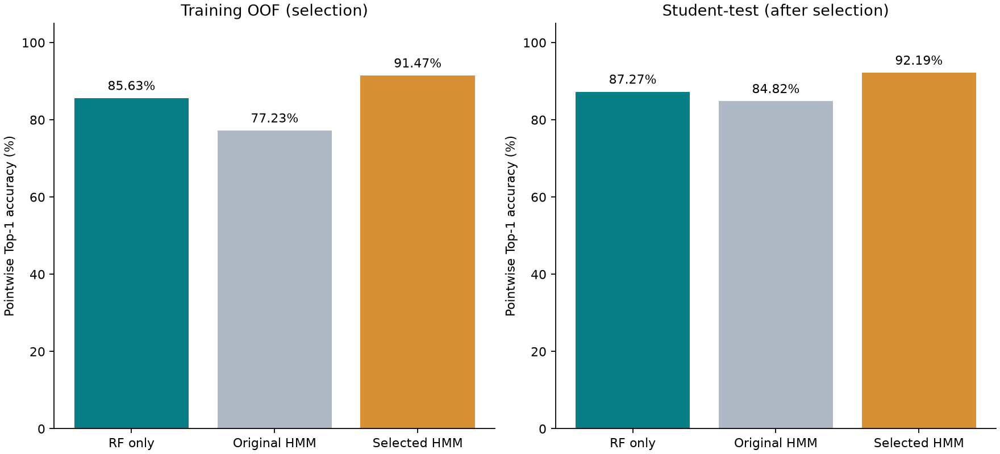

# Training-selected HMM tuning results

Random Forest was reused without retraining. Evaluator data was not used to screen or select decoder configurations.

## Measured comparison

| Pipeline | Training OOF mean-fold Top-1 | Student-test pooled Top-1 |
|---|---:|---:|
| Random Forest | 85.63% | 87.27% |
| Original HMM | 77.23% | 84.82% |
| Selected HMM | 91.47% | 92.19% |



Training OOF values were used for hyperparameter selection and are not an independent post-selection accuracy estimate. Student testing was loaded only after the selected configuration was written; it did not rank trials. Reference labels are derived from monotone route alignment, with the existing 50 m validity threshold.

## Frozen settings

```json
{
  "beta": 25.0,
  "same_arc_jitter_m": 15.0,
  "emission_mode": "probability"
}
```

The search screened 25 configurations on ten training trips (two per fold, seed 42), then checked the best three and the original decoder on all 78 eligible training trips. The final choice maximized mean-fold Top-1, then mean-trip Top-1; exact ties used trial order. The original folds, reference validity and excluded trips were preserved.

A small backwards projection within the chosen jitter tolerance is treated as a stationary observation on the same directed arc. It does not create a reverse road edge. Larger backwards motion still needs a directed return path. The optional log-odds emission score is an emission potential, not a fitted probability calibration model.

Frozen Random Forest SHA-256: `726b503c4ec431232411dcc94f2b443156d6ea43f2ee7bf0fcb8e19a29dc2399`.

## Backend use

Set `PATHSNAP_DECODER_CONFIG` to the completed `decoder_configuration.json` and restart the backend. The classifier hash is checked before loading the decoder settings. The two-client HTTP request/response contract stays the same; see `docs/CLIENT_API.md`.

## Repeat evaluator comparison

Frozen Random Forest: **80.76%**. Training-selected HMM: **90.79%**.
Both use 19,653 valid derived references out of 19,674 observations; 21 references are unresolved.

This evaluator set had already been examined before this optimization task. The repeated result is a development benchmark, not a fresh untouched final estimate. It was computed after the configuration was frozen and was not used to choose parameters. The original 75.41% HMM benchmark is preserved in `outputs/experiments/evaluator_test_rf_hmm_001/`.
